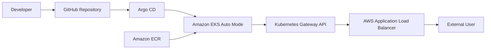

# Deploying a Microservices Retail Store on Amazon EKS Auto Mode

<p align="center">
  <strong>Terraform · Amazon EKS Auto Mode · Argo CD · Gateway API · Amazon ECR</strong>
</p>

<p align="center">
  <a href="https://github.com/pooja-bhavani/retail-store-eks-auto-mode">New Implementation</a> ·
  <a href="https://github.com/pooja-bhavani/retail-store-sample-app">Previous Implementation</a> 
</p>

---

## Project Overview

What does it take to deploy a microservices-based retail application on Amazon EKS without managing the underlying compute infrastructure yourself?

This project explores that using **Amazon EKS Auto Mode**, Terraform, Argo CD, and Kubernetes Gateway API.

I took the retail store application and created a separate implementation focused on simplifying Kubernetes infrastructure management and adopting a GitOps-based deployment workflow.

Terraform provisions the AWS infrastructure, EKS Auto Mode manages compute provisioning, Argo CD continuously reconciles the application from Git, and Gateway API provides external access through an AWS Application Load Balancer.

**The goal:** Build a practical, reproducible deployment that demonstrates how infrastructure provisioning, application delivery, and traffic management fit together on AWS.

> This is a separate implementation repository, not a replacement for my earlier project. You can explore the previous implementation here: [retail-store-sample-app](https://github.com/pooja-bhavani/retail-store-sample-app).

## Architecture


### Architecture workflow

1. **Terraform** provisions the VPC and Amazon EKS cluster.
2. **Amazon EKS Auto Mode** handles workload compute provisioning.
3. **GitHub** stores the application Helm charts and Kubernetes manifests.
4. **Amazon ECR** stores container images.
5. **Argo CD** pulls the desired application configuration from Git and reconciles the cluster.
6. **Kubernetes Gateway API** configures external application access through an AWS Application Load Balancer.
7. The UI communicates with the backend microservices to deliver the retail store experience.

## Technology Stack

| Technology | Purpose |
|---|---|
| AWS | Cloud infrastructure |
| Amazon EKS Auto Mode | Managed Kubernetes compute and infrastructure capabilities |
| Terraform | Infrastructure as Code |
| Amazon VPC | Network isolation and connectivity |
| Amazon ECR | Container image registry |
| GitHub | Source control and GitOps configuration |
| Argo CD | Continuous delivery and GitOps reconciliation |
| Helm | Kubernetes application packaging |
| Kubernetes Gateway API | Application traffic routing |
| AWS Application Load Balancer | External application access |

## Application Microservices

The retail application consists of five core services:

| Service | Responsibility |
|---|---|
| UI Service | Frontend for the retail store |
| Catalog Service | Product catalog and product queries |
| Cart Service | Shopping cart operations |
| Orders Service | Order management and history |
| Checkout Service | Checkout orchestration |

These services work together to provide the retail shopping experience.

## Why Amazon EKS Auto Mode?

Traditional Kubernetes deployments often require teams to manage worker nodes, scaling configurations, and parts of the cluster infrastructure.

With EKS Auto Mode, AWS manages important infrastructure capabilities so that teams can focus more on deploying and operating their workloads.

In this project, I use EKS Auto Mode to:

- Provision compute for Kubernetes workloads.
- Reduce manual worker-node management.
- Integrate application networking through AWS-managed capabilities.
- Run the retail microservices on a managed Kubernetes platform.

## GitOps Workflow

The application deployment follows a GitOps approach.



Argo CD monitors the configured Git repository and reconciles the desired Kubernetes resources with the cluster state.

This makes Git the source of truth for the application deployment configuration.

## Repository Structure

The repository contains the Terraform infrastructure configuration and Kubernetes/GitOps deployment resources.

```text
retail-store-eks-auto-mode/
├── terraform/          # AWS infrastructure using Terraform
├── k8s/                # Kubernetes and Gateway API manifests
├── docs/
│   └── images/         # Architecture diagrams and screenshots
└── README.md
```

Refer to the actual directories in the repository for the complete implementation.

## Prerequisites

Before starting, make sure you have:

- An AWS account with permissions to create the required EKS and networking resources.
- AWS CLI v2
- Terraform
- kubectl
- Helm
- Git
- An AWS region that supports the required EKS Auto Mode capabilities.

**AWS Region used in this implementation:** `ap-south-1` (Mumbai).

Use an appropriately permissioned IAM identity. Avoid using AWS root credentials for deployment.

## Deployment Overview

### 1. Clone the repository

```bash
git clone https://github.com/pooja-bhavani/retail-store-eks-auto-mode.git

cd retail-store-eks-auto-mode
```

### 2. Configure AWS

```bash
aws configure
aws sts get-caller-identity
```

Verify that your AWS CLI is using the intended account and region.

### 3. Provision infrastructure with Terraform

```bash
cd terraform

terraform init
terraform fmt -recursive
terraform validate
terraform plan
terraform apply
```

Review the Terraform plan before applying it.

### 4. Connect to Amazon EKS

Update the kubeconfig using the cluster name created by Terraform:

```bash
aws eks update-kubeconfig \
  --region ap-south-1 \
  --name <YOUR_EKS_CLUSTER_NAME>
```

Verify cluster access:

```bash
kubectl get nodes
kubectl get namespaces
```

EKS Auto Mode provisions compute as workloads require it, so nodes may appear as workloads are scheduled.

### 5. Deploy applications using Argo CD

Install and configure Argo CD according to the deployment configuration in this repository.

Verify the Argo CD applications:

```bash
kubectl get applications -n argocd
```

Check application health and synchronization:

```bash
kubectl get pods -n retail-store
kubectl get applications -n argocd
```

### 6. Configure external access with Gateway API

The application uses Kubernetes Gateway API rather than the previous NGINX Ingress-based approach.

Apply the Gateway API resources according to the manifests in `k8s/`:

```bash
kubectl apply -f k8s/gateway.yaml
```

Check the Gateway status:

```bash
kubectl get gateway -A
kubectl describe gateway -n retail-store
```

Wait for AWS to provision the Application Load Balancer and for the Gateway to receive an address.

### 7. Access the retail store

Check the Gateway address:

```bash
kubectl get gateway -n retail-store
```

Open the assigned address in your browser once the load balancer is ready.

## Verification

Use these commands to verify the deployment:

```bash
kubectl get nodes
kubectl get pods -n retail-store
kubectl get services -n retail-store
kubectl get applications -n argocd
kubectl get gateway -A
kubectl get httproute -A
```

Expected outcome:

- EKS Auto Mode provisions compute for the application.
- Argo CD reports the configured applications as `Synced` and `Healthy`.
- Gateway API provisions an AWS Application Load Balancer.
- The retail store UI is accessible through the Gateway address.
- The UI application does not depend on the old NGINX Ingress setup.

## Security and Cost Considerations

This project creates real AWS resources, which may incur charges.

Before deploying:

- Use least-privilege IAM permissions.
- Keep AWS credentials and Terraform state out of Git.
- Avoid exposing administrative dashboards such as Argo CD publicly.
- Restrict access to any temporary public endpoints.
- Review EKS, compute, load balancer, NAT Gateway, and data-transfer costs.

Always destroy resources when you finish experimenting.

## Cleanup

Remove Kubernetes resources and wait for AWS-managed load balancers to be deleted before destroying the underlying network infrastructure.

Then, from the Terraform directory:

```bash
terraform destroy
```

Review the resources Terraform plans to remove before confirming.

Check the AWS console for any manually created resources that may remain.

## Previous Implementation

This project is a separate implementation of my earlier retail store deployment.

If you want to explore the previous setup, its code, documentation, and deployment workflow, visit:

**[Retail Store Sample App – Previous Implementation](https://github.com/pooja-bhavani/retail-store-sample-app)**

The newer repository focuses on a different infrastructure and traffic-management approach:

| Area | Previous implementation | This implementation |
|---|---|---|
| Kubernetes platform | Amazon EKS | Amazon EKS Auto Mode |
| Infrastructure | Terraform | Terraform |
| Application delivery | GitOps with Argo CD | GitOps with Argo CD |
| External traffic | NGINX Ingress | Gateway API |
| AWS load balancing | NGINX Ingress setup | AWS Application Load Balancer |
| Repository | [Previous repo](https://github.com/pooja-bhavani/retail-store-sample-app) | [Current repo](https://github.com/pooja-bhavani/retail-store-eks-auto-mode) |

The two repositories are maintained separately so that the implementations and their respective histories remain distinct.

## References

- [Amazon EKS Auto Mode documentation](https://docs.aws.amazon.com/eks/latest/userguide/automode.html)
- [Amazon EKS Gateway API documentation](https://docs.aws.amazon.com/eks/latest/userguide/eks-networking.html)
- [Kubernetes Gateway API](https://gateway-api.sigs.k8s.io/)
- [Argo CD documentation](https://argo-cd.readthedocs.io/)
- [Terraform documentation](https://developer.hashicorp.com/terraform/docs)
- [AWS Containers Retail Store Sample App](https://github.com/aws-containers/retail-store-sample-app)

## Author

**Pooja Bhavani**

DevOps & Cloud Engineer | AWS Community Builder – Containers

- [GitHub](https://github.com/pooja-bhavani)
- [LinkedIn](https://www.linkedin.com/in/poojabhavani08-devops/)
- [Hashnode](https://hashnode.com/@Poojabhavani08)

If you find this project useful, consider giving the repository a ⭐.
