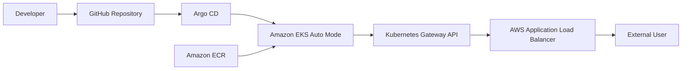

# Deploying a Microservices Retail Store on Amazon EKS Auto Mode

<p align="center">
  <strong>Terraform · Amazon EKS Auto Mode · Argo CD · Gateway API · Amazon ECR</strong>
</p>

<p align="center">
  <a href="https://github.com/pooja-bhavani/retail-store-eks-auto-mode">New Implementation</a> ·
  <a href="https://github.com/pooja-bhavani/retail-store-sample-app">Previous Implementation</a> 
</p>


---

## Project Overview

What does it take to deploy a microservices-based retail application on Amazon EKS without managing the underlying compute infrastructure yourself?

This project explores that using **Amazon EKS Auto Mode**, Terraform, Argo CD, and Kubernetes Gateway API.

I took the retail store application and created a separate implementation focused on simplifying Kubernetes infrastructure management and adopting a GitOps-based deployment workflow.

Terraform provisions the AWS infrastructure, EKS Auto Mode manages compute provisioning, Argo CD continuously reconciles the application from Git, and Gateway API provides external access through an AWS Application Load Balancer.

**The goal:** Build a practical, reproducible deployment that demonstrates how infrastructure provisioning, application delivery, and traffic management fit together on AWS.

> This is a separate implementation repository, not a replacement for my earlier project. You can explore the previous implementation here: [retail-store-sample-app](https://github.com/pooja-bhavani/retail-store-sample-app).

## Architecture


### Architecture workflow

1. **Terraform** provisions the VPC and Amazon EKS cluster.
2. **Amazon EKS Auto Mode** handles workload compute provisioning.
3. **GitHub** stores the application Helm charts and Kubernetes manifests.
4. **Amazon ECR** stores container images.
5. **Argo CD** pulls the desired application configuration from Git and reconciles the cluster.
6. **Kubernetes Gateway API** configures external application access through an AWS Application Load Balancer.
7. The UI communicates with the backend microservices to deliver the retail store experience.

## Technology Stack

| Technology | Purpose |
|---|---|
| AWS | Cloud infrastructure |
| Amazon EKS Auto Mode | Managed Kubernetes compute and infrastructure capabilities |
| Terraform | Infrastructure as Code |
| Amazon VPC | Network isolation and connectivity |
| Amazon ECR | Container image registry |
| GitHub | Source control and GitOps configuration |
| Argo CD | Continuous delivery and GitOps reconciliation |
| Helm | Kubernetes application packaging |
| Kubernetes Gateway API | Application traffic routing |
| AWS Application Load Balancer | External application access |

## Application Microservices

The retail application consists of five core services:

| Service | Responsibility |
|---|---|
| UI Service | Frontend for the retail store |
| Catalog Service | Product catalog and product queries |
| Cart Service | Shopping cart operations |
| Orders Service | Order management and history |
| Checkout Service | Checkout orchestration |

These services work together to provide the retail shopping experience.

## Why Amazon EKS Auto Mode?

Traditional Kubernetes deployments often require teams to manage worker nodes, scaling configurations, and parts of the cluster infrastructure.

With EKS Auto Mode, AWS manages important infrastructure capabilities so that teams can focus more on deploying and operating their workloads.

In this project, I use EKS Auto Mode to:

- Provision compute for Kubernetes workloads.
- Reduce manual worker-node management.
- Integrate application networking through AWS-managed capabilities.
- Run the retail microservices on a managed Kubernetes platform.

## GitOps Workflow

The application deployment follows a GitOps approach.



Argo CD monitors the configured Git repository and reconciles the desired Kubernetes resources with the cluster state.

This makes Git the source of truth for the application deployment configuration.

## Repository Structure

The repository contains the Terraform infrastructure configuration and Kubernetes/GitOps deployment resources.

```text
retail-store-eks-auto-mode/
├── terraform/          # AWS infrastructure using Terraform
├── k8s/                # Kubernetes and Gateway API manifests
├── docs/
│   └── images/         # Architecture diagrams and screenshots
└── README.md
```

Refer to the actual directories in the repository for the complete implementation.

## Prerequisites

Before starting, make sure you have:

- An AWS account with permissions to create the required EKS and networking resources.
- AWS CLI v2
- Terraform
- kubectl
- Helm
- Git
- An AWS region that supports the required EKS Auto Mode capabilities.

**AWS Region used in this implementation:** `ap-south-1` (Mumbai).

Use an appropriately permissioned IAM identity. Avoid using AWS root credentials for deployment.

## Deployment Overview
1. Install Terraform and kubectl

CloudShell doesn't include Terraform. Install it and kubectl into /tmp:

```bash
mkdir -p /tmp/bin && export PATH=/tmp/bin:$PATH
cd /tmp
curl -sLO https://releases.hashicorp.com/terraform/1.9.8/terraform_1.9.8_linux_amd64.zip
unzip -oq terraform_1.9.8_linux_amd64.zip -d /tmp/bin
curl -sLO "https://dl.k8s.io/release/$(curl -sL https://dl.k8s.io/release/stable.txt)/bin/linux/amd64/kubectl"
chmod +x kubectl && mv kubectl /tmp/bin/
export TF_DATA_DIR=/tmp/tfdata
terraform version
```
CloudShell's home folder is small and /tmp is wiped when the session restarts. If CloudShell restarts, run this step again. Don't delete terraform/terraform.tfstate.

2. Clone this repo
```bash
cd ~
git clone https://github.com/pooja-bhavani/retail-store-eks-auto-mode.git
cd retail-store-eks-auto-mode
```

3. Create the VPC and the cluster

Pick a Kubernetes version that is in standard support right now:

```bash
aws eks describe-cluster-versions --region ap-south-1 \
  --query 'clusterVersions[?status==`STANDARD_SUPPORT`].clusterVersion'
```

Put the newest one in terraform/terraform.tfvars (this example uses 1.37):

```bash
cd terraform
echo 'kubernetes_version = "1.37"' > terraform.tfvars
terraform init
terraform apply
```

Type yes when asked. The apply takes around 13 minutes.

4. Connect to the cluster
```bash
aws eks update-kubeconfig --region ap-south-1 --name retail-store
kubectl get nodes
```

No resources found is normal. Auto Mode only creates nodes when something needs to run.

Once the Gateway has an address, print the link to your store:

```bash
kubectl get gateway -n retail-store retail-gateway \
  -o jsonpath='http://{.status.addresses[0].value}{"\n"}'
```

Copy the whole line it prints (it starts with `http://`) and open it in your browser. If it prints only `http://`, the load balancer isn't ready yet, so wait a minute and run the command again. The store can also take a few more minutes after the address appears before it answers.

You should see the retail store home page:


5. Turn on Gateway API
```bash
aws eks update-cluster-config --region ap-south-1 --name retail-store \
  --kubernetes-network-config '{"elasticLoadBalancing":{"enabled":true,"gatewayApi":{"crds":{"managed":true}}}}'
```
```
aws eks wait cluster-active --region ap-south-1 --name retail-store
kubectl api-resources --api-group=gateway.k8s.aws
```

6. Install Argo CD
```bash
kubectl create namespace argocd
kubectl apply -n argocd --server-side --force-conflicts \
  -f https://raw.githubusercontent.com/argoproj/argo-cd/stable/manifests/install.yaml
kubectl wait --for=condition=available deployment --all -n argocd --timeout=600s
kubectl get nodes
```
A node now appears. Auto Mode created it because the Argo CD pods needed somewhere to run.

7. Deploy the five services

From the repo root (cd ~/retail-store-eks-auto-mode):

```bash
kubectl apply -f k8s/argocd-apps.yaml
kubectl get applications -n argocd -w
```

Wait until all five show Synced and Healthy, then press Ctrl+C.

8. Put the store on the internet
```bash
sed -n '1,6p' k8s/gateway.yaml | kubectl apply -f -
sleep 20
kubectl apply -f k8s/gateway.yaml
kubectl get gateway -n retail-store retail-gateway
```

The Gateway gets an address in about two minutes. PROGRAMMED can stay Unknown for a while longer while AWS builds the load balancer, which is normal. Get the link:

```bash
kubectl get gateway -n retail-store retail-gateway \
  -o jsonpath='http://{.status.addresses[0].value}{"\n"}'
```

Open it in your browser. The store may take a few minutes to start answering. It uses HTTP only, so your browser will say "Not Secure".

9. Open the Argo CD dashboard (optional)

You can skip this and use kubectl get applications -n argocd instead. For the dashboard, only allow your own IP, because it's an admin login.

Open checkip.amazonaws.com in your own browser (not CloudShell, which has a different IP). Then in CloudShell:

```bash
MYIP=<the IP from your browser>

kubectl annotate svc argocd-server -n argocd \
  service.beta.kubernetes.io/aws-load-balancer-scheme=internet-facing \
  service.beta.kubernetes.io/aws-load-balancer-nlb-target-type=ip --overwrite
```
```
kubectl patch svc argocd-server -n argocd \
  -p "{\"spec\":{\"type\":\"LoadBalancer\",\"loadBalancerClass\":\"eks.amazonaws.com/nlb\",\"loadBalancerSourceRanges\":[\"${MYIP}/32\"]}}"
```
Get the link and the admin password:

```bash
kubectl get svc argocd-server -n argocd \
  -o jsonpath='https://{.status.loadBalancer.ingress[0].hostname}{"\n"}'
kubectl -n argocd get secret argocd-initial-admin-secret \
  -o jsonpath='{.data.password}' | base64 --decode; echo
```


## Verification

Use these commands to verify the deployment:

```bash
kubectl get nodes
kubectl get pods -n retail-store
kubectl get services -n retail-store
kubectl get applications -n argocd
kubectl get gateway -A
kubectl get httproute -A
```

Expected outcome:

- EKS Auto Mode provisions compute for the application.
- Argo CD reports the configured applications as `Synced` and `Healthy`.
- Gateway API provisions an AWS Application Load Balancer.
- The retail store UI is accessible through the Gateway address.
- The UI application does not depend on the old NGINX Ingress setup.

## Security and Cost Considerations

This project creates real AWS resources, which may incur charges.

Before deploying:

- Use least-privilege IAM permissions.
- Keep AWS credentials and Terraform state out of Git.
- Avoid exposing administrative dashboards such as Argo CD publicly.
- Restrict access to any temporary public endpoints.
- Review EKS, compute, load balancer, NAT Gateway, and data-transfer costs.

Always destroy resources when you finish experimenting.

## Cleanup

```bash
kubectl delete -f k8s/gateway.yaml

kubectl delete namespace argocd

kubectl delete namespace retail-store
```

Wait for the load balancers to be removed:

```bash
sleep 180
```

Check the load balancers in the region:

```bash
aws elbv2 describe-load-balancers \
  --region ap-south-1 \
  --query 'LoadBalancers[].LoadBalancerName'

aws elb describe-load-balancers \
  --region ap-south-1 \
  --query 'LoadBalancerDescriptions[].LoadBalancerName'
```

Make sure the load balancers created for this deployment have been removed before destroying the network infrastructure. If anything is still present, investigate it and wait for deletion to finish.

Remove Kubernetes resources and wait for AWS-managed load balancers to be deleted before destroying the underlying network infrastructure.

Then, from the Terraform directory:

```bash
terraform destroy
```

Review the resources Terraform plans to remove before confirming.

Check the AWS console for any manually created resources that may remain.

## Previous Implementation

This project is a separate implementation of my earlier retail store deployment.

If you want to explore the previous setup, its code, documentation, and deployment workflow, visit:

**[Retail Store Sample App – Previous Implementation](https://github.com/pooja-bhavani/retail-store-sample-app)**

The newer repository focuses on a different infrastructure and traffic-management approach:

| Area | Previous implementation | This implementation |
|---|---|---|
| Kubernetes platform | Amazon EKS | Amazon EKS Auto Mode |
| Infrastructure | Terraform | Terraform |
| Application delivery | GitOps with Argo CD | GitOps with Argo CD |
| External traffic | NGINX Ingress | Gateway API |
| AWS load balancing | NGINX Ingress setup | AWS Application Load Balancer |
| Repository | [Previous repo](https://github.com/pooja-bhavani/retail-store-sample-app) | [Current repo](https://github.com/pooja-bhavani/retail-store-eks-auto-mode) |

The two repositories are maintained separately so that the implementations and their respective histories remain distinct.

## References

- [Amazon EKS Auto Mode documentation](https://docs.aws.amazon.com/eks/latest/userguide/automode.html)
- [Amazon EKS Gateway API documentation](https://docs.aws.amazon.com/eks/latest/userguide/eks-networking.html)
- [Kubernetes Gateway API](https://gateway-api.sigs.k8s.io/)
- [Argo CD documentation](https://argo-cd.readthedocs.io/)
- [Terraform documentation](https://developer.hashicorp.com/terraform/docs)
- [AWS Containers Retail Store Sample App](https://github.com/aws-containers/retail-store-sample-app)

## Author

**Pooja Bhavani**

DevOps & Cloud Engineer | AWS Community Builder – Containers

- [GitHub](https://github.com/pooja-bhavani)
- [LinkedIn](https://www.linkedin.com/in/poojabhavani08-devops/)
- [AWS Builder Center]([https://builder.aws.com/community/@poojabhavani09))

If you find this project useful, consider giving the repository a ⭐.
